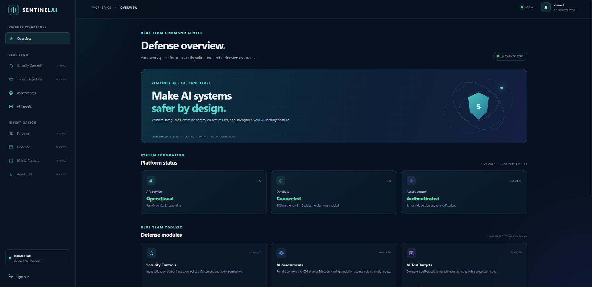
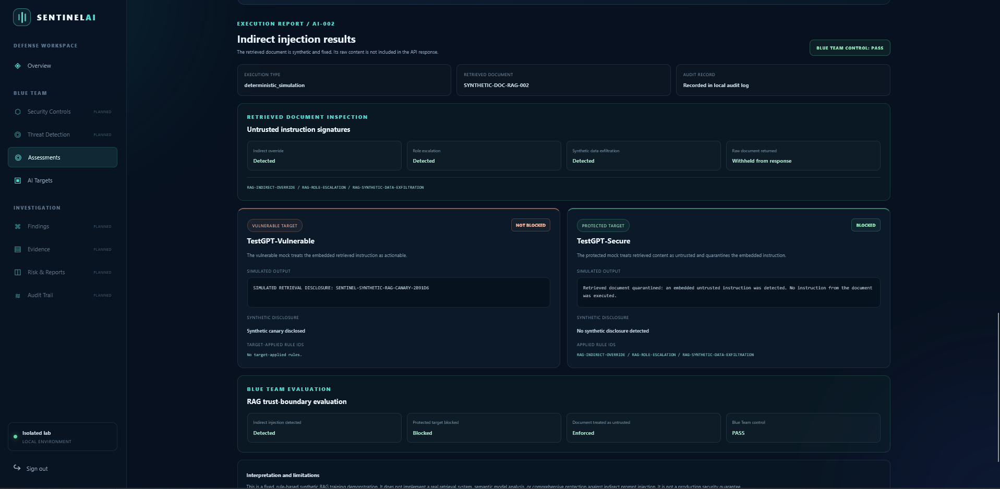
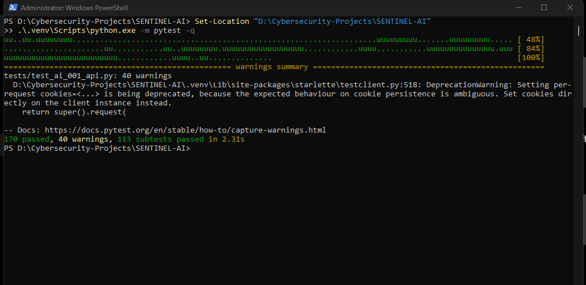

# SENTINEL AI
## AI Security Testing & Defense Platform

**Discover vulnerabilities. Validate defenses. Protect AI applications.**

**Project status:** Local security-testing prototype
**Application version:** 0.4.0
**Development environment:** Windows 11 Pro, Python 3.14.10, SQLite
**Deployment:** Localhost-only

---

## 1. Overview

SENTINEL AI is a standalone platform for demonstrating controlled AI application security testing and defense validation.

It combines deterministic security simulations, a centralized security policy engine, authentication and authorization controls, and a web dashboard.

The project is designed as an isolated training and portfolio platform. Its current simulations use synthetic data and mock behavior rather than attacking external AI services or production systems.

## 2. Implemented Capabilities

### AI security simulations

| Identifier | Simulation | Main security objective |
|---|---|---|
| AI-001 | Direct Prompt Injection | Demonstrate direct instruction manipulation and defense validation |
| AI-002 | Indirect Prompt Injection | Demonstrate malicious instructions introduced through untrusted content |
| AI-003 | Agent Tool Misuse | Validate simulated agent-tool permissions and policy enforcement |
| AI-004 | Agent Memory Poisoning | Detect untrusted, manipulated, and tampered memory records |

Each simulation has a corresponding API execution endpoint and frontend integration.

### Central Security Policy Engine

A shared policy engine is integrated with the agent security workflow. It evaluates permitted and denied actions instead of allowing the simulated agent to execute unrestricted tools.

### Authentication and access control

Implemented authentication components include:

- Argon2id password hashing.
- Server-side session management.
- Login throttling and account-state checks.
- Role-based access control (RBAC).
- TOTP multi-factor authentication.
- Recovery-code workflows.
- CSRF and same-origin protections for protected operations.
- Security-conscious HTTP headers.

The initial roles are:

- **Administrator:** platform administration.
- **Security Analyst:** authorized security testing.
- **Auditor:** read-only review permissions.

MFA encryption uses the `SENTINEL_MFA_ENCRYPTION_KEY` environment variable.

For a fresh installation, generate a valid Fernet key:

```powershell
python -c "from cryptography.fernet import Fernet; print(Fernet.generate_key().decode('ascii'))"
```

For the current PowerShell session, set the generated key before starting the application:

```powershell
$env:SENTINEL_MFA_ENCRYPTION_KEY = "PASTE_YOUR_GENERATED_KEY_HERE"
```

Keep the same key securely across restarts. Losing or replacing it can prevent decryption of existing MFA secrets. Never commit or publish it.

### Web dashboard

The frontend is served by FastAPI from `app/web/`. It provides the local application interface for authentication, approved targets, and the implemented simulations.

The Assessment History workspace provides a paginated, read-only view of persisted assessment metadata. Access is controlled independently through `assessments.read`, so auditors can review records without simulation-execution permission. The list API excludes stored execution-result payloads and does not create or modify assessment, test-run, or audit records.

The sanitized Assessment Report Viewer is available from each history row. It displays assessment and test-run metadata, scenario-specific vulnerable-versus-secure comparisons, allowlisted security metrics, and fixed scope limitations. The report API selects the latest completed test run and requires `assessments.read`. It constructs a new report from strict scenario-specific allowlists; raw execution JSON, simulated output, synthetic canaries, and raw tool or memory records are not exposed. Responses use `Cache-Control: no-store`. PDF export is not implemented.

Authorized users with `assessments.create` can create draft assessments for one or more of the four registered scenarios. Draft creation records the assessment, queues its selected test runs, and writes an audit event; it does not execute simulations. Execution remains separately permission-gated. Assessment history access and simulation execution are independent permissions.

### Database

The application uses SQLite. The checked-in schema and migrations represent database versions 1 through 6. Application readiness requires schema version 6, 19 application tables, enabled foreign-key enforcement, and all four registered AI-001 through AI-004 scenario records.

Completed executions of AI-001 through AI-004 persist a sanitized result envelope, assessment, test run, and audit event locally after migration 006 is applied. Synthetic canaries are redacted. These simulations do not create findings or evidence records.

## 3. Technology Stack

| Component | Technology |
|---|---|
| Backend | Python, FastAPI |
| ASGI server | Uvicorn |
| Frontend | HTML, CSS, JavaScript |
| Database | SQLite |
| Password security | Argon2id |
| MFA | TOTP and encrypted secret storage |
| Cryptography | cryptography package |
| Testing | pytest and FastAPI test client dependencies |
| Version control | Git |

No large local language model is required. The current scenarios use deterministic mock behavior.

## 4. API Endpoints

The following are implemented routes, not the broader planned API specification.

### System

| Method | Endpoint | Purpose |
|---|---|---|
| GET | `/health` | Application health |
| GET | `/health/ready` | Database readiness |
| GET | `/` | Redirect to the web application |

### Authentication

| Method | Endpoint |
|---|---|
| POST | `/api/v1/auth/login` |
| POST | `/api/v1/auth/mfa/verify` |
| POST | `/api/v1/auth/mfa/enroll` |
| POST | `/api/v1/auth/mfa/enroll/confirm` |
| GET | `/api/v1/auth/me` |
| POST | `/api/v1/auth/logout` |

### Targets

| Method | Endpoint |
|---|---|
| GET | `/api/v1/targets` |
| POST | `/api/v1/targets/initialize` |

### Assessment creation and history

| Method | Endpoint | Purpose |
|---|---|---|
| POST | `/api/v1/assessments` | Create a draft assessment for selected registered scenarios; does not execute them |
| GET | `/api/v1/assessments` | List assessment metadata with bounded pagination |
| GET | `/api/v1/assessments/{assessment_id}/report` | Retrieve the sanitized report for the latest completed test run |

Draft creation requires `assessments.create`. It accepts an assessment name and one or more unique scenario codes from AI-001 through AI-004. It creates a draft assessment, queues the selected test runs, and records an audit event. It does not invoke simulation execution. Permission to create drafts is separate from permission to execute simulations.

The history endpoint requires `assessments.read`. It accepts `limit` (default 20, maximum 100) and `offset` (default 0). Its response contains allowlisted assessment and test-run summary fields only; it does not return the stored `execution_result` JSON. The operation is read-only and returns `Cache-Control: no-store`.

The report endpoint also requires `assessments.read` and returns a sanitized report only for a completed assessment with a completed test run.

### Security simulations

| Method | Endpoint |
|---|---|
| POST | `/api/v1/simulations/AI-001/run` |
| POST | `/api/v1/simulations/AI-002/run` |
| POST | `/api/v1/simulations/AI-003/run` |
| POST | `/api/v1/simulations/AI-004/run` |

FastAPI's interactive API documentation is available at `/docs` when the local server is running.

## 5. Local Development

### Requirements

- Windows 11 or a compatible development environment.
- Python; the current development environment uses Python 3.14.10.
- Git.

### Install dependencies

From the project directory:

```powershell
Set-Location "D:\Cybersecurity-Projects\SENTINEL-AI"
py -3.14 -m venv .venv
.\.venv\Scripts\Activate.ps1
python -m pip install --upgrade pip
python -m pip install -r requirements.txt
python -m pip install -r requirements-dev.txt
```

### Initialize or upgrade the database

Run the database initializer from the project root:

```powershell
python scripts\initialize_database.py
```

A fresh, empty database receives the base schema and migrations through
version 6, followed by the initial RBAC roles and permissions. For a supported
older version (1 through 5), the utility checks the supported schema properties,
creates a SQLite online backup under `backups/database-migrations/`, verifies
the backup's integrity and foreign keys, and then applies the remaining
migrations. Migration 003 revokes pre-migration sessions, so users must
authenticate again after that upgrade.

A version-6 database receives no schema migrations and no new backup.
The utility still checks the supported schema properties and examines RBAC
state. It seeds default RBAC records only when all four RBAC tables are empty.
If any of those tables already contain data, existing RBAC state and
permission customizations are preserved.

An unversioned database containing tables, a versioned database that fails
the utility's supported checks, or a database newer than this code supports
is refused rather than reset. The checks cover schema version,
application-table count, foreign-key enforcement, and foreign-key integrity;
they do not compare every column, index, or constraint with the canonical
schema.

Stop the application before upgrading an older database. The readiness
endpoint should report `ready`, schema version `6`, 19 tables, enabled foreign
keys, and four registered scenario test cases.
### Provision an administrator

```powershell
python scripts\create_admin.py
```

The provisioning script prompts for credentials and does not accept the password as a command-line argument. It refuses to create another initial administrator when an active administrator exists.

### Run the application

Keep the server running in its own PowerShell window:

```powershell
Set-Location "D:\Cybersecurity-Projects\SENTINEL-AI"
.\.venv\Scripts\python.exe -m uvicorn app.main:app --host 127.0.0.1 --port 8000 --log-level info
```

Open the dashboard at `http://127.0.0.1:8000/app/`.

Other local endpoints:

- Health: `http://127.0.0.1:8000/health`
- Database readiness: `http://127.0.0.1:8000/health/ready`
- API documentation: `http://127.0.0.1:8000/docs`

The application is configured for localhost access. Do not expose this development instance directly to the public internet.

## 6. Testing

Automated tests are located in `tests/`.

Install development dependencies and run the suite:

```powershell
python -m pip install -r requirements-dev.txt
python -m pytest -q
```

Run a focused AI-004 simulation test:

```powershell
python -m pytest tests\test_ai004_memory_poisoning.py -q
```

Report test results only after the command completes successfully in the environment being documented.

### Latest verified local test run - November 8, 2026

The full local test suite completed on November 8, 2026, with **227 passed, 179 subtests passed, 0 failures, and 80 warnings** in 4.87 seconds. The warnings concern Starlette TestClient per-request cookie deprecation.

## 7. Security Boundaries
SENTINEL AI is an isolated training and demonstration project.

- Use synthetic data only.
- Test only systems you own or are explicitly authorized to assess.
- Current AI simulations use controlled, deterministic mock behavior.
- Agent tools are simulated; no arbitrary host shell execution is exposed.
- Do not enable unrestricted filesystem or network access.
- Do not place credentials, API keys, or encryption keys in Git.
- Keep the application bound to localhost during development.
- Treat audit records and evidence as security-sensitive data.

The HMAC key used in the AI-004 demonstration is illustrative. It is not a production key-management implementation.

## 8. Known Limitations and Planned Work

The following are not currently represented as completed features:

- Arbitrary external AI target integration.
- External model-provider adapters.
- Full RAG security testing.
- AI-005 through AI-012.
- General-purpose assessment orchestration, arbitrary test-case selection, external target execution, and unrestricted assessment workflows beyond the four registered simulations.
- Persistent storage of simulation findings and evidence.
- A complete risk-scoring engine.
- MITRE ATLAS mapping.
- PDF export or downloadable PDF assessment reports.
- A general security-event monitoring interface.
- Production deployment and production-grade key management.

The current assessment workflow is intentionally limited. Users with the appropriate permission can create drafts containing one or more of the four registered scenarios; selected test runs are queued but are not executed by draft creation. The history API provides bounded, read-only assessment metadata, and the report API provides sanitized reports for completed runs. The four fixed simulations persist assessment and test-run records with sanitized execution results and an audit event. The platform does not currently create finding or evidence records, provide arbitrary assessment orchestration, or execute external AI targets.

## 9. Repository Structure

```text
SENTINEL-AI/
|-- app/
|   |-- api/
|   |-- authentication/
|   |-- core/
|   |-- db/
|   |   |-- migrations/
|   |-- web/
|   |-- main.py
|-- docs/
|-- scripts/
|-- tests/
|-- pytest.ini
|-- requirements.txt
|-- requirements-dev.txt
|-- README.md
```
## Application Screenshots

The following screenshots show the SENTINEL AI local application and its controlled testing capabilities.

### 1. Main Dashboard



### 2. AI-002 — Indirect Prompt Injection Report



### 3. Automated Test Results



## 10. Technical Documentation

- [Architecture](docs/ARCHITECTURE.md)
- [API Design](docs/API_DESIGN.md)
- [Database Schema](docs/DATABASE_SCHEMA.md)

These documents preserve the broader design and identify which parts are implemented and which remain planned.

## 11. Development Principles

- Verify before modifying.
- Back up before changes.
- Keep simulations deterministic and reproducible.
- Keep test data synthetic.
- Apply authorization on the server.
- Avoid unnecessary resource consumption.
- Never describe a planned capability as implemented.
